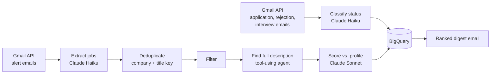

# Job Alert Agent

An on-demand pipeline that turns a noisy inbox of job alerts into one ranked shortlist.

It reads job alert emails from LinkedIn, Indeed, Built In, Dice and Wellfound, uses Claude to extract and score each posting, removes anything already seen or already applied to, and stores everything in BigQuery for SQL analysis.

**Why:** a typical week brings 50+ alert emails and 300+ postings, most of them repeats, wrong-fit roles, or jobs I already applied to. This tool reduces that to a short list worth acting on.

## How it works



| Stage | What it does | Status |
|---|---|---|
| 1. Read | Gmail API pulls alert emails since the last run | Done |
| 2. Extract | Claude returns structured JSON per job (company, title, location, remote, salary, link) | Done |
| 3. Dedupe + status | Skips seen jobs; reads confirmation, rejection and interview emails to track application status automatically | Done |
| 4. Filter | Seniority, unrelated roles (keywords, then one Claude call), $100K hard floor / $120K soft target, remote grouping | Done |
| 5. Describe | Tool-using agent finds the posting (job board page, web search, Greenhouse/Lever/Ashby APIs) and extracts evaluation criteria, not the full text | Done |
| 6. Score | Experience and preferences fit, Python-test risk, top gaps, unusual notes, best resume version | Next |
| 7. Digest | HTML email: Apply today / Maybe / Onsite / Filtered out | Planned |
| 8. Run button | GitHub Actions manual trigger | Planned |

## Design decisions

**Links are replaced with short labels before calling the model.**
Job board links are hundreds of characters of tracking parameters. Each URL becomes `[L7]` before the email goes to Claude, and Claude answers with the label. Python then maps it back and strips tracking (for example, a LinkedIn redirect becomes `linkedin.com/jobs/view/<id>`). This is cheaper, and the model can't mistype a URL.

**Structured outputs instead of parsing free text.**
Every Claude call uses a JSON schema (`output_config.format`), so responses always parse and match the expected columns.

**Status comes from email, not manual updates.**
Application confirmations, rejections and interview invites are classified by Claude and stored as events. A job's current status is computed with SQL (latest matching event, using `QUALIFY ROW_NUMBER()`), never stored, so it can't drift out of sync.

**Append-only BigQuery tables on the free sandbox.**
The sandbox allows no streaming inserts or UPDATE statements, and deletes every table 60 days after it was created. The pipeline adds rows only with batch load jobs. On every run it rebuilds each table with `CREATE OR REPLACE TABLE t AS SELECT * FROM t`, which keeps the rows and restarts the 60-day clock.

My first approach, pushing the expiration date out, passed a test on a brand-new table but failed on a 5-day-old one: the limit counts from creation, not from today. Re-testing on an aged table caught it, and the rebuild approach replaced it.

**The agent extracts criteria, not descriptions.**
Scoring needs facts like must-have skills, Python expectations, management scope, remote rules and travel, not 2,000 words of marketing copy. The Haiku agent returns a compact JSON of those facts, so the Sonnet scoring call is smaller, cheaper and more focused. The criteria are stored as JSON in BigQuery and can be queried with `JSON_VALUE` / `JSON_QUERY_ARRAY`.

**Right-sized models.**
Claude Haiku handles high-volume reading (extraction, status emails). Claude Sonnet handles the judgment call (scoring). Expected cost is about $1 per run.

**Incremental runs.**
Each run reads only email since the previous run (from the `runs` table), so repeat runs take seconds. The first run looks back 90 days for application history and processes about 550 emails in parallel in about 8 minutes.

## Data model (BigQuery)

| Table | Grain | Key columns |
|---|---|---|
| `jobs` | one row per unique posting | `job_key` (normalized company + title), source, salary, link, scores |
| `status_events` | one row per application, rejection or interview email | `event`, `company_key`, `job_key`, `email_date` |
| `runs` | one row per pipeline run | counts per stage, `run_time` (watermark for the next run) |

## Project layout

```
main.py              runs the pipeline
gmail_client.py      Gmail API: search, read, decode MIME parts
extract.py           stage 2: email -> jobs (HTML to text, link labels, tracking cleanup)
dedupe.py            stage 3: normalized job keys
status.py            stage 3: classify application, rejection and interview emails
store.py             BigQuery: tables, load jobs, status SQL
filters.py           stage 4: seniority, relevance, salary, remote
describe_agent.py    stage 5: tool-using agent -> criteria JSON
resumes.py           reads resume .docx files (kept out of git)
config.yaml          senders, phrases, models, thresholds (no code changes needed)
get_refresh_token.py one-time Google OAuth login (writes to .env)
save_samples.py      saves real emails locally as test fixtures
```

## Tech

Python 3.12 · Gmail API · BigQuery · Anthropic Claude API (Haiku, Sonnet) · GitHub Actions

## Running it yourself

1. Create a Google Cloud project, enable the Gmail and BigQuery APIs, and create an OAuth client of type **Desktop app**. Save it as `credentials.json`.
2. `python -m venv venv` and `pip install -r requirements.txt`
3. `python get_refresh_token.py` (logs in to Google and saves the token to `.env`)
4. Add `ANTHROPIC_API_KEY` to `.env` (see `.env.example`).
5. Set your BigQuery project in `config.yaml`, then run `python main.py`.

Secrets live only in `.env` locally and in GitHub Secrets for Actions. Neither is committed.

## How this was built

Designed and built by me, pair-programming with Claude Code (an AI coding assistant), step by step: each stage was tested on real data before moving to the next.
